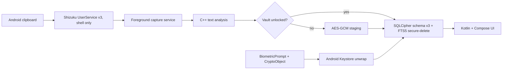

# ClipVault

ClipVault is an offline-first encrypted clipboard archive for Android. It captures text through a narrowly scoped Shizuku bridge, stores the vault in SQLCipher, and requires a strong biometric-backed Android Keystore key for every unlock.

[فارسی](README_FA.md) · [Security](SECURITY.md) · [Architecture](docs/ARCHITECTURE.md) · [DeX completion](docs/WP06_COMPLETION.md) · [Backup format](docs/BACKUP_FORMAT.md)


## What it does

- Captures clipboard text in the background through Shizuku with an event callback and adaptive polling fallback.
- Keeps the primary database encrypted with SQLCipher and stages locked-state captures using AES-256-GCM.
- Unlocks the database key only through `BiometricPrompt`, `BIOMETRIC_STRONG`, a real `CryptoObject`, and Android Keystore.
- Classifies Instagram, YouTube, Telegram, TikTok, X, GitHub, links, dates, Persian, English, mixed text, email, phone, code and JSON in the native C++ layer.
- Provides encrypted FTS5 search, advanced filters, smart collections, custom collections, tags, notes, pinning, favorites and complete multi-selection actions.
- Uses recoverable deletion with a 30-day Trash and retention policies from one month to forever or 7–365 custom days.
- Exports and imports versioned `.cvault` files protected with Argon2id and AES-256-GCM.
- Offers System, Light, Dark and AMOLED themes, Android 12+ Dynamic Color, six accent palettes and live preview.
- Supports Persian RTL and English LTR layouts.
- Samsung DeX QuickPaste window: open via the long-press **Quick paste** shortcut or the optional, separately enabled **ClipVault Quick paste** launcher entry for Samsung's hardware-keyboard app shortcut. Type to search, use ↑/↓ and Enter (or click a result) to copy, Esc to close, then paste manually into the target app. **Keep open after copy** defaults OFF; turn it ON in QuickPaste to make multiple copies without closing. It does not auto-paste or stay always on top.

ClipVault has no `INTERNET` permission, analytics, account system, cloud sync or telemetry.

## Architecture



The UI and presentation layer use Kotlin, Compose, Navigation, StateFlow and Paging 3. Security, SQLCipher persistence and Shizuku lifecycle code remain explicit Java boundaries. Deterministic text analysis lives in C++20/JNI. See [Architecture](docs/ARCHITECTURE.md) for the data flow and invariants.

## Build

Requirements:

- Android Studio with JDK 17 or 21
- Android SDK Platform `37.0`, target SDK 36
- Android NDK `27.2.12479018`
- CMake `3.22.1`

Windows:

```powershell
$env:JAVA_HOME = "C:\Program Files\Android\Android Studio\jbr"
$env:ANDROID_HOME = "$env:LOCALAPPDATA\Android\Sdk"
.\gradlew.bat testDebugUnitTest lintDebug externalNativeBuildDebug assembleDebug
```

Linux/macOS:

```bash
./gradlew testDebugUnitTest lintDebug externalNativeBuildDebug assembleDebug
```

The debug APK is written to `app/build/outputs/apk/debug/app-debug.apk`. Release signing keys must be configured outside the repository; no keystore or signing secret belongs in source control.

For repeated Windows real-device / Samsung DeX checks, use the data-preserving one-command deploy script:

```powershell
powershell.exe -NoProfile -ExecutionPolicy Bypass -File .\scripts\deploy-debug.ps1
```

It builds incrementally, installs with `adb install -r`, and opens Main Vault. `-SkipBuild` reuses the existing APK; `-LaunchOnly` opens the already installed app. **Do not run `connectedDebugAndroidTest` against your personal vault device** (the Gradle task can uninstall the app). See [Windows device validation / debug deployment](docs/DEVICE_DEBUG_DEPLOY.md) for setup, signing-key cautions and the compact-search checklist.

## Device setup

1. Enroll a strong fingerprint or other `BIOMETRIC_STRONG` credential.
2. Install and start [Shizuku](https://shizuku.rikka.app/guide/setup/) using wireless debugging or ADB. Root and Sui backends are refused because clipboard access only needs the shell identity.
3. Install the APK with `adb install -r app/build/outputs/apk/debug/app-debug.apk`.
4. Open ClipVault and create the biometric-protected vault.
5. Grant the Shizuku and notification permissions, then enable capture in Settings or the Quick Settings tile.

Shizuku normally needs to be started again after a reboot on non-rooted devices. Android and vendor ROM changes can affect hidden clipboard APIs; ClipVault reports bridge health and falls back to adaptive polling instead of hiding failures.

## Security boundary

Biometrics protect key use, not merely a screen. The SQLCipher key is random, never persisted as plaintext, and is wrapped by a non-exportable Keystore AES-GCM key. Clipboard contents are never logged. Screenshots and recent-app previews are blocked with `FLAG_SECURE`. Android cloud backup and device transfer are disabled.

Read [SECURITY.md](SECURITY.md) and the [threat model](docs/THREAT_MODEL.md) before treating the project as a password manager or a substitute for an independently audited secrets vault.

## Status

The Samsung Galaxy S23 Ultra / Android 16 / One UI 8 DeX UX from WP-06, WP-06S and WP-06P-A is implemented and device-validated; PRs [#15](https://github.com/NeonBee/ClipVault/pull/15), [#16](https://github.com/NeonBee/ClipVault/pull/16) and [#17](https://github.com/NeonBee/ClipVault/pull/17) are merged into `hardening/base`. The final #17 verify and instrumentation CI passed ([run #79](https://github.com/NeonBee/ClipVault/actions/runs/40662764365)). See [completion evidence, limits and remaining work](docs/WP06_COMPLETION.md). The planned WP-07 Secure Copy / Secure Paste path is **not implemented**; normal QuickPaste copies plaintext to the Android system clipboard.

Version `2.0.0` builds against API 37 and compiles all four Android ABIs. Its device suite covers all theme modes, navigation, multi-selection, Trash recovery, encrypted backup failure modes, native/fallback parity, the real v1 → v2 migration and indexed search over 20,000 encrypted clips. The security/data suite and a live Shizuku protocol-v2 UserService bind have also passed on an Android 13 HyperOS device. Shizuku clipboard behavior still needs validation across more vendor ROMs before a production security claim would be responsible.
